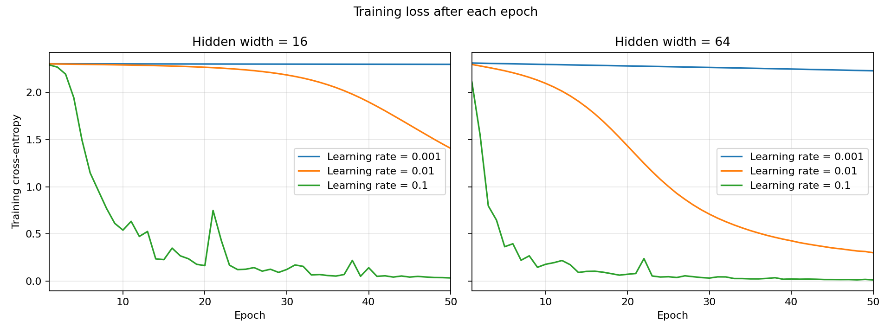

# Lab 2: A Neural Network from Scratch

## 1. Goal

I wanted to understand how a neural network learns by building its calculations myself. I compared two network sizes and three learning rates to see how much they affect accuracy and learning. I also measured forward and backward time to see which part takes longer and how this changes with the size of the network.

## 2. Method

I used the same folder structure and Python 3.11.8 environment from Lab 1. I saved the package versions in results/versions.txt. MLflow is still missing because of the dependency conflict documented in Lab 1.

I used the digits dataset: 1,797 images with 64 values each, representing handwritten digits from 0 to 9. I divided the pixel values by 16 to put them between 0 and 1. I converted each label into a one-hot vector with 10 positions.

I used a stratified 70/30 split with random_state=42, giving 1,257 training images and 540 test images. All experiments used the same split. I set the Python, NumPy, PyTorch, and CUDA seeds to 42. The generators for weights and shuffling also used seed 42.

I designed two networks, both with 64 inputs, two hidden layers, and 10 outputs. One had 16 neurons in each hidden layer and the other had 64. Both used ReLU in the hidden layers and softmax at the output. The smaller network had 1,482 parameters and the larger one had 8,970.

I interpreted the manual's N(0, 0.01) as mean 0 and variance 0.01, giving a standard deviation of 0.1. The manual does not specify whether the second number is variance or standard deviation. Biases started at zero.

I implemented the calculations with NumPy using float64, without automatic differentiation. I checked and measured the following:

- Forward pass: I checked that a batch of 32 images produced an output of shape (32, 10), with each row summing to 1 within 1e-6.
- Loss: I used mean cross-entropy and checked that the initial loss was close to ln(10), approximately 2.3026.
- Gradients: I implemented backpropagation and checked 10 random weights per network, covering all three weight matrices. I changed each selected weight by plus and minus 1e-5 and compared the numerical gradient with the analytical one.
- Training: I used learning rates of 0.001, 0.01, and 0.1 for both widths. Each experiment ran for 50 epochs with shuffled batches of 32 and a final batch of 9. I updated the parameters using mini-batch gradient descent without momentum.
- Results: I recorded training loss and accuracy after every epoch. I measured test accuracy after the final epoch of each experiment.
- Timing: I ran one warm-up and then 100 measurements of forward and backward separately, reporting the median. I used the saved models and the same batch of 32 training images.

Networks of the same width started with the same weights. Every experiment used the same shuffle sequence. For timing, backward used previously calculated intermediate values. Model loading, data preparation, scalar loss evaluation, and weight updates were outside the timers. All measurements came from my Windows computer.

## 3. Results

Both networks passed the forward checks. The initial losses were 2.312799 for width 16 and 2.343699 for width 64, close to the expected 2.3026.

Both networks passed all 10 gradient checks with relative errors below 1e-6. The manual required at least 9 out of 10.

| Hidden width | Learning rate | Final training loss | Training accuracy | Test accuracy |
|---|---:|---:|---:|---:|
| 16 | 0.001 | 2.297603 | 0.1981 | 0.1778 |
| 16 | 0.01 | 1.406536 | 0.6571 | 0.6556 |
| 16 | 0.1 | 0.033434 | 0.9920 | 0.9648 |
| 64 | 0.001 | 2.229071 | 0.3723 | 0.3574 |
| 64 | 0.01 | 0.300228 | 0.9324 | 0.9130 |
| 64 | 0.1 | 0.012515 | 0.9992 | 0.9685 |

With learning rate 0.001, both networks made little progress in 50 epochs. With 0.01, the larger network learned more within the same number of epochs. With 0.1, both reached much lower losses, although the loss sometimes increased between epochs.

The highest test accuracy was 96.85% for width 64 with learning rate 0.1. The smaller network reached 96.48% with the same learning rate. This was only two more correct predictions out of 540 images for the larger network.

The following times are medians in milliseconds per batch of 32 images.

| Hidden width | Learning rate | Forward (ms) | Backward (ms) |
|---|---:|---:|---:|
| 16 | 0.001 | 0.01880 | 0.01720 |
| 16 | 0.01 | 0.01920 | 0.01720 |
| 16 | 0.1 | 0.01900 | 0.01730 |
| 64 | 0.001 | 0.02840 | 0.03375 |
| 64 | 0.01 | 0.02690 | 0.03210 |
| 64 | 0.1 | 0.02835 | 0.03350 |

For width 16, forward took slightly longer. For width 64, backward took about 18-19% longer. Both operations took longer with the larger network.

Our forward pass uses three matrix multiplications. Backward uses five to calculate weight gradients and pass gradients to earlier layers. Increasing the width makes these matrices larger and increases the work.

However, forward also calculates softmax, and both operations create intermediate arrays. These costs may help explain why forward was slightly slower for the small network. I did not measure each internal operation separately, so I cannot confirm the exact cause. These short timings also depend on the computer and library settings.

## 4. Conclusions

1. I learned that the learning rate can change the results a lot, even with the same network and data. With 0.001, the networks made little progress in 50 epochs. With 0.1, both performed much better. This does not mean that increasing the learning rate will always improve a model.

2. What surprised me was that the larger network had about six times as many parameters but only got two more test images right at learning rate 0.1. For this task, I would consider the smaller network because its accuracy was very close and both its forward and backward passes were faster.

3. Implementing the gradients helped me understand how the network adjusts its weights. Checking them numerically gave me evidence that the calculations were correct. I also learned that backward is not always slower: it took longer for width 64, but slightly less time for width 16.

Sources: Lab Manual, global rules and Lab 2; Vijay Janapa Reddi, Introduction to Machine Learning Systems. The manual lists Chapter 3 topics; the corresponding topics in the supplied edition are in Chapter 5, sections 5.3-5.5.

## Handwritten calculations

[Handwritten calculations (PDF)](results/lab2.pdf)