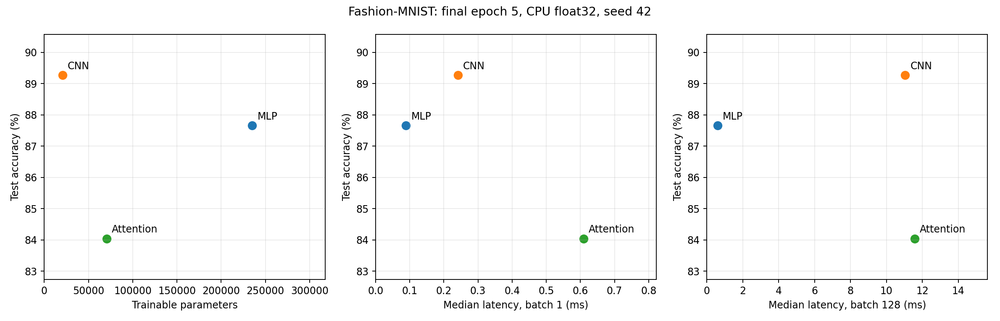

# Lab 3: Architectures and Their Costs

## 1. Goal

I compared an MLP, a CNN and an attention model on Fashion-MNIST. I wanted to understand how accuracy, parameter count, FLOPs and inference latency change with the architecture, and how memory-access patterns help explain the trade-offs.

## 2. Method

I used Python 3.11.8, PyTorch 2.3.1+cpu, torchvision 0.18.1+cpu, torchinfo 1.8.0, THOP 0.1.1.post2209072238, NumPy 1.26.4 and Matplotlib 3.9.0. All installed package versions are saved in results/versions.txt.

I loaded Fashion-MNIST through torchvision with ToTensor and Normalize((0.2860,), (0.3530,)). I randomly split the official training set into 55,000 training and 5,000 validation images using seed 42, and used the official 10,000 test images. The transformed data was cached in RAM.

I implemented the manual's explicit architectures:

- MLP: Flatten 784, Linear 256, ReLU, Linear 128, ReLU, Linear 10.
- CNN: Conv2d 1->16, ReLU, MaxPool2, Conv2d 16->32, ReLU, MaxPool2, Flatten, Linear 1568->10. Both convolutions use 3x3 kernels and padding 1.
- Attention: sixteen 7x7 patches, Linear 49->64, two Transformer encoder layers with d_model=64, four heads and feed-forward width 128, mean pooling, Linear 64->10. The encoders use default ReLU, dropout 0.1 and post-normalization. No positional encoding is added.

The manual also gives a target of 100k-150k parameters. The explicit layers instead produce 235,146, 20,490 and 70,794 parameters. These two requirements cannot be met at the same time. I kept the specified layers, so this comparison does not use an equal parameter budget.

Each model trained for five epochs with Adam, learning rate 0.001, batch size 128 and cross-entropy on logits. The final batch had 88 images. I used seed 42 for Python, NumPy, PyTorch and CUDA, enabled deterministic algorithms and used the same training shuffle sequence. Validation was evaluated after each epoch. Test accuracy comes from epoch 5.

All experiments used CPU float32 with four intra-op threads and one inter-op thread. For inference, I used eval and inference_mode, one warm-up, then 100 runs for batch 1 and 20 runs for batch 128. I report median milliseconds per whole batch. Model loading, preprocessing and input creation were outside the timer. The timed inputs were synthetic tensors of shape (batch, 1, 28, 28); these models perform fixed dense computation for those shapes.

I counted parameters with torchinfo.summary and compared analytical FLOPs with thop.profile. One MAC counts as two FLOPs. The cost comparison includes matrix products and convolutions, excluding bias additions, activations, pooling, softmax, normalization, residual additions and reductions.

## 3. Results

| Model | Test accuracy | Parameters | Matrix FLOPs / image | Batch 1 median (ms) | Batch 128 median (ms) |
|---|---:|---:|---:|---:|---:|
| MLP | 0.8766 | 235,146 | 469,504 | 0.089350 | 0.606000 |
| CNN | 0.8927 | 20,490 | 2,063,488 | 0.241200 | 11.048450 |
| Attention | 0.8404 | 70,794 | 2,329,856 | 0.609100 | 11.583350 |

The representative-layer calculations use one image:

| Layer | Analytical FLOPs | THOP MACs | THOP FLOPs (2 x MACs) |
|---|---:|---:|---:|
| Linear 784->256 | 401,408 | 200,704 | 401,408 |
| Conv2d 1->16, 3x3, output 28x28 | 225,792 | 112,896 | 225,792 |
| Self-attention, 16 tokens, dimension 64, 4 heads | 589,824 | 294,912 | 589,824 |

Linear costs 2 x 784 x 256 = 401,408 FLOPs. The first convolution costs 2 x 3 x 3 x 1 x 16 x 28 x 28 = 225,792 FLOPs. One self-attention module costs 393,216 FLOPs for QKV projections, 32,768 for QK transpose, 32,768 for attention times V and 131,072 for the output projection: 589,824 in total. This excludes the encoder's separate feed-forward layers. The handwritten sheets include the calculation steps.

| Model | Default THOP operation estimate | Adjusted matrix MACs | Adjusted matrix FLOPs |
|---|---:|---:|---:|
| MLP | 234,752 | 234,752 | 469,504 |
| CNN | 1,031,744 | 1,031,744 | 2,063,488 |
| Attention | 591,488 | 1,164,928 | 2,329,856 |

For MLP and CNN, default THOP counts the main matrix MACs; multiplying by two matches the FLOP convention. For attention, it misses functional QKV and output projections and the attention matrix products, but includes LayerNorm operations. Its default total therefore has incomplete coverage and mixed counting conventions. I added a MultiheadAttention counting rule and excluded LayerNorm from the adjusted matrix-only comparison. The representative attention row uses this adjusted rule. It is an analytical profiling rule, not a hardware measurement. For THOP only, fused encoder inference is disabled so child-module hooks run. Native inference settings are restored for timing.

The CNN obtained the highest test accuracy, 1.61 percentage points above the MLP, with about 11.5 times fewer parameters. Its small filters are shared across spatial positions. Neighboring windows also reuse input values, creating opportunities for cache reuse. Applying filters at many positions explains why the CNN can have fewer parameters but more FLOPs than the MLP.

The MLP had the lowest measured latency. Its dense layers use regular matrix operations, with opportunities to reuse weights across a batch. In this setup, it offers lower latency at the cost of more parameters and slightly lower accuracy than the CNN.

Attention combines projections, global patch interactions, feed-forward layers, residual connections and normalization. Q, K, V and attention scores create intermediate data movement; pairwise interactions grow quadratically with sequence length. Dense attention here still uses structured matrix operations. These patterns do not prove a particular physical memory bottleneck, since memory bandwidth and cache misses were not measured.

For this experiment, the CNN offers the best accuracy/parameter trade-off, while the MLP is preferable when latency matters most. Attention was slower and less accurate here. Without positional encoding, its mean-pooled output also loses whole-patch order. These results concern one seed, five epochs, unequal model sizes and this CPU setup.

## 4. Conclusions

1. I learned that parameter count and FLOPs describe different costs. The CNN stored fewer weights but reused them across many positions, performing more arithmetic than the MLP.
2. I would choose the CNN when accuracy and parameter storage matter most. The MLP is another option when lower inference latency is more important.
3. I learned that profiling results need a common counting convention. MACs must be converted to FLOPs, and missing attention operations must be accounted for before comparing architectures. Latency still needs measuring.

Sources: supplied Lab Manual, global rules and Lab 3; Vijay Janapa Reddi, Introduction to Machine Learning Systems, Chapter 4, sections 4.2, 4.3, 4.5, 4.6 and 4.7; installed PyTorch 2.3.1 and THOP source code.

## Handwritten calculations

[Handwritten calculations (PDF)](results/lab3.pdf)