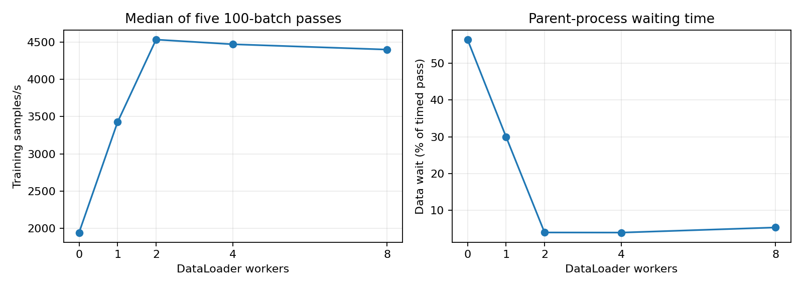
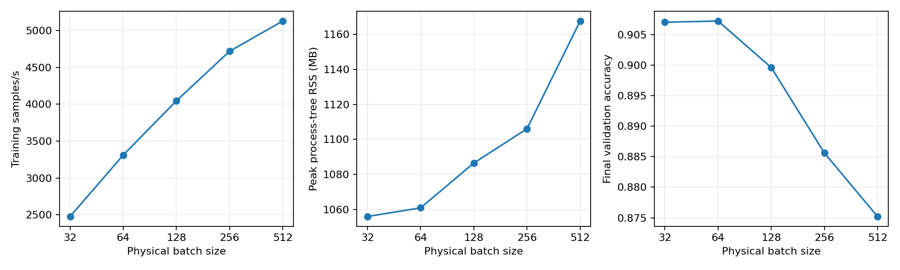
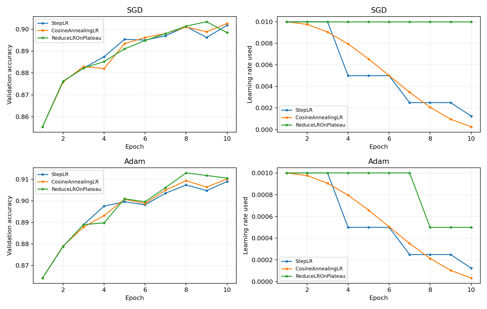
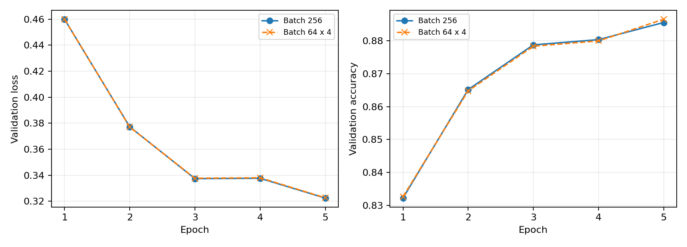
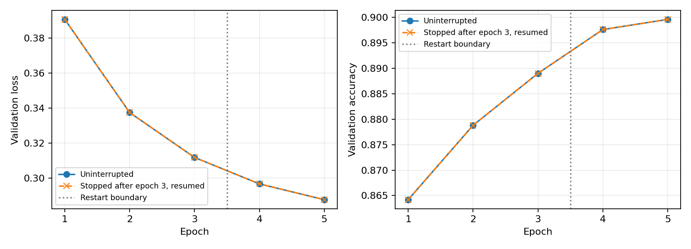

# Lab 6: Training Systems and Experiment Tracking

## 1. Goal

I compared the training pipeline settings for the best architecture from Lab 3. I measured data loading, batch size and learning-rate schedules, then checked gradient accumulation and checkpoint recovery. I also prepared my individual project proposal.

## 2. Method

The Lab 3 CNN had the highest recorded test accuracy there: 89.27%, compared with 87.66% for the MLP and 84.04% for attention. I reused its exact architecture, with 20,490 parameters, and started each Lab 6 experiment from the same freshly seeded weights. Lab 6 model selection uses validation results; the official test set is evaluated only after each completed training run.

I used Fashion-MNIST with 55,000 training, 5,000 validation and 10,000 test images. The training/validation membership is fixed with seed 42. Images use ToTensor and normalization with mean 0.2860 and standard deviation 0.3530. Python, NumPy, PyTorch and CUDA seeds are set to 42. Training uses CPU float32, four intra-op threads, one inter-op thread and deterministic algorithms. Each worker uses one thread. Package versions are in [versions.txt](results/versions.txt).

One YAML object controls the dataset, model, training and study settings. [config.yaml](config.yaml) is the starting configuration; [resolved_config.yaml](results/resolved_config.yaml) records the selected worker count. Each run logs the complete effective configuration, its SHA-256, parameters, per-epoch metrics and artifacts to real local MLflow runs.

Each training trial runs sequentially in a separate process. Before timing, one batch is trained on a disposable copy of the model to start the workers and warm up execution. Timed epochs include batch retrieval, forward, backward, optimizer updates and loop overhead. Validation, MLflow logging and checkpoint writing are outside the training timer. Throughput is training samples divided by epoch time. These CPU timings can vary with machine load; the study order is not randomized.

Memory is sampled every 0.01 s using psutil. I report peak parent RSS and the peak sum of parent and worker RSS, in decimal MB. Process-tree RSS can count shared pages more than once, and sampling may miss short peaks. It is a process-memory estimate, not a measurement of model tensors alone.

Checkpoints contain the model, optimizer, scheduler, completed epoch, history, configuration, MLflow run ID and Python/NumPy/PyTorch/loader random states. The sampler derives each epoch's order from seed + epoch. This keeps ordering independent of how far worker prefetching has advanced.

Lab 6 uses a separate environment because MLflow 2.14.1 requires PyArrow below 16, while the earlier environment has PyArrow 16.1.0. From the repository root, create it with `.\.venv\Scripts\python.exe -m venv .venv-lab06`, then install with `.\.venv-lab06\Scripts\python.exe -m pip install -r lab06\requirements.txt`. Run all studies with `.\.venv-lab06\Scripts\python.exe lab06\src\run_pipeline.py`.

## 3. Results

### DataLoader workers

I compared 0, 1, 2, 4 and 8 workers with batch size 128. Each timed pass contains 100 training batches, or 12,800 samples. There is one complete untimed warm-up pass followed by five independently initialized timed passes. The table uses medians. Startup is measured separately and excluded from steady-state throughput.

| Workers | Startup (s) | Samples/s | Data wait |
| --- | --- | --- | --- |
| 0 | 0.13 | 1944.5 | 56.49% |
| 1 | 8.47 | 3425.3 | 29.99% |
| 2 | 16.75 | 4531.9 | 3.89% |
| 4 | 32.88 | 4469.5 | 3.87% |
| 8 | 63.01 | 4398.4 | 5.26% |

I selected 2 workers because this setting had the highest median throughput. Data waiting fell from 56.5% with no workers to 3.9%. The zero-worker pipeline was limited by loading and transformations. Beyond the selected count, extra workers did not improve the median throughput, while Windows process startup increased. At that point, training computation and coordination limited the benefit of further loading parallelism. The short worker benchmark is a controlled comparison, not an end-to-end startup benchmark.

Raw repetitions: [worker_times_raw.csv](results/worker_times_raw.csv).

### Profile of one complete epoch

I used torch.profiler on one full training epoch with batch 128 and the selected workers. Four non-overlapping outer ranges cover data retrieval, forward including loss, backward and optimizer.step. Remaining loop and profiler overhead is shown separately. Data loading measures waiting visible in the parent; it does not add CPU work done asynchronously inside workers. The profiler changes execution cost, so these shares describe the profiled epoch.

| Stage | Time (ms) | Epoch wall time |
| --- | --- | --- |
| data_loading | 440.9 | 3.21% |
| forward_pass | 6526.2 | 47.56% |
| backward_pass | 5302.4 | 38.64% |
| optimizer_step | 943.3 | 6.87% |
| other_and_profiler_overhead | 510.4 | 3.72% |

Details: [profile_breakdown.csv](results/profile_breakdown.csv) and [profile_operators.csv](results/profile_operators.csv).

### Batch size

All five settings ran for five epochs with Adam, learning rate 0.001 and StepLR with step size 3 and factor 0.5. Throughput is the median of the five timed epochs. Memory is the maximum sampled training RSS across those epochs. Final validation and test accuracy are shown separately.

| Batch | Samples/s | Parent RSS (MB) | Tree RSS (MB) | Validation accuracy | Test accuracy |
| --- | --- | --- | --- | --- | --- |
| 32 | 2477.7 | 434.2 | 1056.0 | 90.70% | 90.56% |
| 64 | 3311.6 | 439.3 | 1061.0 | 90.72% | 90.21% |
| 128 | 4046.5 | 464.8 | 1086.5 | 89.96% | 89.28% |
| 256 | 4718.0 | 498.6 | 1106.0 | 88.56% | 88.30% |
| 512 | 5127.9 | 541.7 | 1167.5 | 87.52% | 87.41% |

A larger batch changes both system utilization and optimization: it makes fewer optimizer updates during the same five epochs. Higher throughput does not imply better final accuracy. These measurements include the dataset, Python runtime and workers, so RSS need not grow monotonically with batch size.

Full table: [batch_summary.csv](results/batch_summary.csv).

### Optimizer and learning-rate schedule

Each of the six combinations ran for ten epochs with batch 128 and the same data order and initial weights. SGD uses momentum 0.9 and initial learning rate 0.01; Adam uses 0.001. StepLR multiplies the learning rate by 0.5 after every three epochs. CosineAnnealingLR uses T_max=10 and eta_min=0.00001. ReduceLROnPlateau monitors validation loss, with patience 1 and factor 0.5. The plots show the learning rate actually used during each epoch.

| Optimizer | Schedule | Validation loss | Validation accuracy | Test accuracy |
| --- | --- | --- | --- | --- |
| SGD | StepLR | 0.2753 | 90.18% | 90.35% |
| SGD | CosineAnnealingLR | 0.2723 | 90.26% | 90.40% |
| SGD | ReduceLROnPlateau | 0.2683 | 89.84% | 90.38% |
| Adam | StepLR | 0.2620 | 90.90% | 90.16% |
| Adam | CosineAnnealingLR | 0.2582 | 91.02% | 90.28% |
| Adam | ReduceLROnPlateau | 0.2543 | 91.06% | 90.31% |

The highest final validation accuracy was 91.06%, from Adam with ReduceLROnPlateau. This is a comparison of these configured combinations under equal epoch budgets. Different initial learning rates and one seed mean it does not isolate an optimizer's general superiority. A plateau schedule only lowers the rate when its monitored loss stops improving; it may keep the initial rate during a short run.

Full table: [schedule_summary.csv](results/schedule_summary.csv).

### Gradient accumulation

I compared physical batch 64 with four accumulated backward passes against physical batch 256 for five epochs. The optimizer updates only after the accumulated group. Summed cross-entropy is divided by the actual group size, including the last group of 216 examples, so an incomplete group is not underweighted. Both runs use 215 optimizer updates per epoch.

The maximum gradient difference on the same initial 256-example update was 3.725e-08. After five epochs, the absolute validation accuracy difference was 0.0010 and the loss difference was 0.000197. These satisfy the predefined tolerances of 0.01 accuracy and 0.03 loss. The runs need not be bitwise identical because different physical batch shapes can change floating-point operation order.

Checks: [accumulation_check.csv](results/accumulation_check.csv) and [accumulation_comparison.csv](results/accumulation_comparison.csv).

### Stop and resume

I intentionally stopped a five-epoch run after epoch 3, then resumed it in a separate process for the remaining epochs. The resumed run uses the same MLflow run ID. The epoch-3 checkpoint is retained as an artifact, together with the final checkpoint. Model, optimizer, scheduler and random states were restored before continuing.

The validation loss, accuracy, training metrics and learning rates match the uninterrupted batch-128 run exactly at every epoch. The maximum final parameter difference is 0.0. There is no reset at epoch 4. Wall times and RSS are expected to differ after restarting and are excluded from the equality check.

Checks: [resume_check.csv](results/resume_check.csv) and [resume_comparison.csv](results/resume_comparison.csv).

### MLflow evidence

The submission contains 19 genuine completed MLflow runs: five worker settings, five batch settings, six optimizer/schedule settings, one profile, one accumulation run and one interrupted/resumed run. Run IDs and evidence counts are in [mlflow_runs.csv](results/mlflow_runs.csv). The native tracking files, per-epoch metrics, configurations, histories and checkpoint artifacts are packaged in [mlflow_runs.zip](results/mlflow_runs.zip).

To inspect the archive on another checkout, run `.\.venv-lab06\Scripts\python.exe lab06\src\run_pipeline.py --restore-tracking`. This restores a separate local store and prints the MLflow UI command with its correct location. Run that command using `.\.venv-lab06\Scripts\mlflow.exe` in place of `mlflow` and open the local address it reports. Artifact paths are adjusted to the new checkout; the original metric histories are retained.

### Individual project proposal

[One-page proposal](../project/proposal.pdf): local SMS spam classification using the public UCI SMS Spam Collection, TF-IDF and a small neural model. I plan to compare FP32 with dynamic INT8 quantization. Proposed targets are spam F1 >= 0.90, p95 complete CPU inference <= 50 ms, deployed artifacts <= 5 MB and at most 0.01 absolute F1 loss after quantization. The proposal includes my name and student ID. The dataset and scope are awaiting instructor approval; these are planned targets, not achieved measurements.

## 4. Conclusions

1. Data loading can leave the training process waiting. I need to measure throughput before increasing worker counts, because additional processes also cost startup time and memory.
2. Batch size, optimizer and schedule affect both execution and learning. Equal epochs do not mean equal optimizer updates, and speed should be compared with final validation quality.
3. Reproducible recovery requires more than saved weights. Restoring the optimizer, scheduler, data order and random states preserved the uninterrupted training trajectory in this deterministic experiment.

Sources: supplied Lab 6 manual; Vijay Janapa Reddi, Introduction to Machine Learning Systems, Chapter 8 (training architecture, loading, optimization, profiling and section 8.7), Chapter 5 section 5.5 and Chapter 13 section 13.3. Project dataset: [UCI SMS Spam Collection](https://archive.ics.uci.edu/dataset/228/sms), DOI [10.24432/C5CC84](https://doi.org/10.24432/C5CC84).
