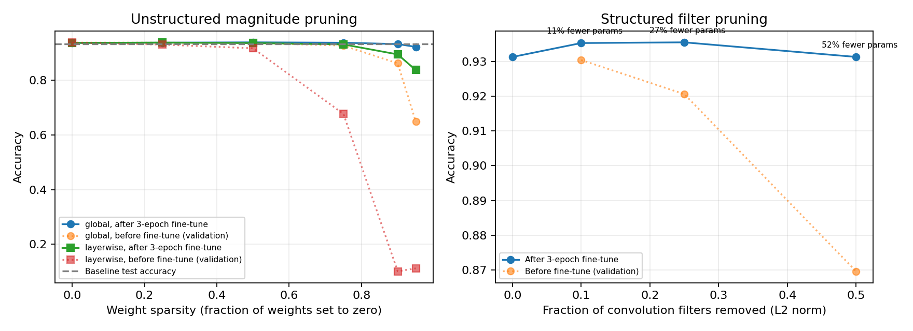
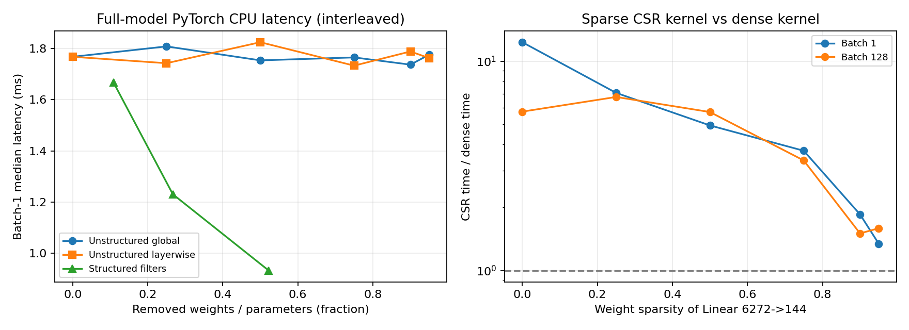
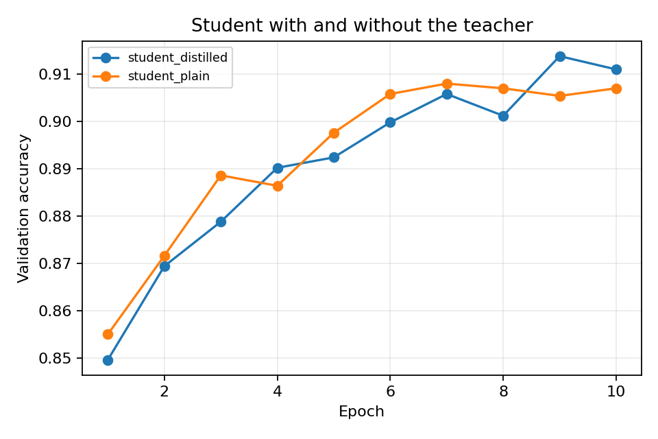

# Lab 7: Pruning, Sparsity and Knowledge Distillation

## 1. Goal

I trained a deliberately oversized CNN on Fashion-MNIST, then made it cheaper in three ways: unstructured magnitude pruning, structured filter pruning and knowledge distillation into a small student. For every variant I measured accuracy, parameters, MACs, serialized size, CPU latency and an energy estimate, and I checked whether fewer weights really mean faster inference.

## 2. Method

I used Fashion-MNIST with 55,000 training, 5,000 validation and 10,000 test images; the split is fixed with seed 42. Training and inference run on CPU float32 with four intra-op threads, one inter-op thread and deterministic algorithms. Selection uses validation accuracy; the test set is reported for completed models. Package versions are in [versions.txt](results/versions.txt). Run everything from the repository root with `.\.venv\Scripts\python.exe lab07\src\run_lab.py`. Checkpoints are written to `data/lab07/`, which is not committed.

The teacher is Conv(1→32)–Conv(32→64)–pool–Conv(64→128)–pool–Dropout–Linear(6272→144)–Linear(144→10): 997,434 parameters and 30.0 M MACs per image ([models.py](src/models.py)). It was trained for 10 epochs with Adam and learning rate 0.001. 90.5% of its parameters are in the first linear layer.

- **Unstructured pruning.** I used `torch.nn.utils.prune` with L1 magnitude on all convolution and linear weights at 0, 25, 50, 75, 90 and 95% sparsity, in two variants. *Global* ranks all weights together; *layerwise* removes the same fraction from every layer. Each pruned model is fine-tuned for 3 epochs at learning rate 0.0003 with the masks fixed. The script asserts that the masks did not change during fine-tuning, then makes the zeros permanent with `prune.remove`.
- **Structured pruning.** I removed 10, 25 and 50% of the filters of each convolution by L2 norm. The kept filters, the matching input channels of the next convolution and the matching columns of the first linear layer are copied into a physically smaller model, which is fine-tuned in the same way.
- **Distillation.** The student is Conv(1→16)–pool–Conv(16→32)–pool–Linear(1568→60)–Linear(60→10): 99,550 parameters, 10× fewer than the teacher. A plain student and a distilled student start from the same initial weights and train for 10 epochs with the same data order. The distilled loss is `alpha · T² · KL(teacher_T ‖ student_T) + (1 − alpha) · CE(student, labels)` with T = 4 and alpha = 0.5. In PyTorch, this is `F.kl_div(log_softmax(student/T), softmax(teacher/T))`, which computes KL from the teacher distribution to the student. The manual writes the arguments in the opposite order, but this is the standard Hinton form; the T² factor keeps the soft-target gradients comparable to the hard-label term.

Size is the byte length of `torch.save(state_dict)`. I report three forms: dense, gzip-compressed dense, and a sparse copy where every weight matrix is stored as CSR. MACs are counted with forward hooks; "nonzero MACs" count only multiplications by nonzero weights, which is the work a perfect sparse kernel would do.

**Latency.** Latency is the median of 100 batch-1 or 12 batch-128 forward passes on fixed random input, after 5 warm-ups. I first measured each model right after its own training stage. Those numbers were not comparable: the unpruned `global_0` checkpoint measured 1.69 ms, while the identical baseline architecture measured 1.19 ms an hour earlier. Machine state changed between stages. I therefore added [remeasure_latency.py](src/remeasure_latency.py). It loads all 17 checkpoints in one process and times them in 5 rounds, each in a new seeded random order, and reports the median of the round medians. All latency in this report comes from [latency_interleaved.csv](results/latency_interleaved.csv). The per-stage measurements remain in the stage CSVs as raw data.

**Sparse kernel.** I timed the first linear layer of each layerwise model directly: dense `F.linear` against `torch.sparse.mm` with the weight in CSR form, at batch sizes 1 and 128.

**Energy.** Energy is estimated with codecarbon 2.4.2 in offline mode while each selected model classifies the test set three times. My AMD Ryzen 9 7945HX is not supported for power readings, so codecarbon falls back to a constant 42.5 W CPU plus 11.7 W RAM. The estimate is therefore proportional to the measurement window; it tracks time, not a measured power difference.

## 3. Results

### Baseline

| Model | Parameters | MACs/image | Validation | Test | Dense size | Batch-1 | Batch-128 |
| --- | --- | --- | --- | --- | --- | --- | --- |
| Teacher CNN | 997,434 | 30.0 M | 93.64% | 93.13% | 3.99 MB | 1.78 ms | 101.6 ms |

Training took 928 s ([baseline_history.csv](results/baseline_history.csv)).

### Unstructured pruning

| Sparsity | Method | Validation before fine-tune | Test after fine-tune | Nonzero MACs | gzip size | CSR size | Batch-1 |
| --- | --- | --- | --- | --- | --- | --- | --- |
| 0% | – | 93.64% | 93.53% | 30.0 M | 3.71 MB | 11.97 MB | 1.77 ms |
| 25% | global | 93.62% | 93.61% | 27.2 M | 3.01 MB | 8.98 MB | 1.81 ms |
| 25% | layerwise | 92.90% | 93.64% | 22.5 M | 3.02 MB | 8.98 MB | 1.74 ms |
| 50% | global | 93.48% | 93.73% | 22.9 M | 2.16 MB | 5.99 MB | 1.75 ms |
| 50% | layerwise | 91.56% | 93.46% | 15.0 M | 2.16 MB | 5.99 MB | 1.82 ms |
| 75% | global | 92.54% | 93.59% | 14.6 M | 1.28 MB | 3.00 MB | 1.77 ms |
| 75% | layerwise | 67.62% | 92.98% | 7.5 M | 1.28 MB | 3.00 MB | 1.73 ms |
| 90% | global | 86.08% | 93.10% | 7.8 M | 0.69 MB | 1.21 MB | 1.74 ms |
| 90% | layerwise | 10.16% | 89.33% | 3.0 M | 0.70 MB | 1.21 MB | 1.79 ms |
| 95% | global | 64.80% | 92.08% | 4.8 M | 0.47 MB | 0.61 MB | 1.78 ms |
| 95% | layerwise | 11.24% | 83.62% | 1.5 M | 0.47 MB | 0.61 MB | 1.76 ms |

The 0% row is the teacher after the same 3 extra epochs; it gained 0.4 points from the additional training alone, so pruned rows should be compared with it.

The dense file size never changes: zeros still take 4 bytes each, and every pruned model is 3.99 MB. Gzip compression turns the zeros into real savings. CSR stores a 4-byte value and an 8-byte column index for every nonzero, so it is larger than dense below about 67% sparsity and only wins at 75% and above.

Global pruning keeps accuracy much better than layerwise pruning. At 90%, global loses 0.4 points against the fine-tuned 0% model, while layerwise loses 4.2. Before fine-tuning the difference is extreme: 86.1% against 10.2%, which is chance level. The per-layer table explains why ([unstructured_layer_sparsity.csv](results/unstructured_layer_sparsity.csv)). Global pruning puts most of the zeros in the large 6272→144 layer, which has redundant weights, and protects the 288-weight first convolution. Layerwise pruning forces 90% of that tiny layer to zero. The price is that global pruning removes fewer MACs (7.8 M against 3.0 M at 90%), because the convolutions do almost all of the computation.

### Structured pruning

| Filters removed | Kept filters | Parameters | MACs/image | Validation before fine-tune | Test | Dense size | Batch-1 | Batch-128 |
| --- | --- | --- | --- | --- | --- | --- | --- | --- |
| 10% | 29/58/115 | 888,665 | 24.7 M | 93.04% | 93.53% | 3.56 MB | 1.67 ms | 94.4 ms |
| 25% | 24/48/96 | 731,194 | 17.1 M | 92.06% | 93.55% | 2.93 MB | 1.23 ms | 75.3 ms |
| 50% | 16/32/64 | 476,474 | 7.8 M | 86.96% | 93.13% | 1.91 MB | 0.93 ms | 39.6 ms |

Removing half the filters keeps the baseline test accuracy, halves the dense file and cuts batch-128 latency by 61%. The pruned model is an ordinary smaller dense network, so every standard kernel benefits ([structured_pruning.csv](results/structured_pruning.csv)).

### Latency: why unstructured sparsity did not help

On the left, every unstructured model runs at 1.73–1.82 ms at batch 1, the same as the baseline. These models still contain dense tensors, so PyTorch's dense convolution and GEMM kernels multiply every zero exactly as they would any other number. Only structured pruning, which changes tensor shapes, lowers latency.

On the right, I tested a real sparse kernel on the 6272→144 layer ([sparse_kernel_latency.csv](results/sparse_kernel_latency.csv)). CSR matrix multiplication was slower than the dense kernel at every sparsity: 12.3× slower at 0% and still 1.3–1.6× slower at 95%. Dense kernels use contiguous memory, SIMD and cache blocking. CSR has to load an index for every value, follows irregular memory access and does too little work per element to amortize that overhead on a CPU. Unstructured sparsity therefore helps storage and transfer (gzip or CSR at high sparsity), but it only helps speed with hardware or kernels built for it, such as 2:4 structured sparsity on recent NVIDIA GPUs.

### Knowledge distillation

| Student | Validation | Test | Training time | Batch-1 | Batch-128 |
| --- | --- | --- | --- | --- | --- |
| Plain (labels only) | 90.70% | 90.40% | 132 s | 0.39 ms | 15.1 ms |
| Distilled (T = 4, alpha = 0.5) | 91.10% | 91.11% | 493 s | 0.39 ms | 15.5 ms |

The same architecture gained 0.71 test points from the teacher's soft targets. Training time includes a teacher forward pass for every batch, which made distillation 3.7× more expensive to train. The two students have identical inference cost. The distilled student is still 2.0 points below the teacher, with 10× fewer parameters, 27× fewer MACs and 4.6× lower batch-1 latency. This is one seed, so a 0.7-point gain is suggestive but not a confidence interval.

### Efficiency summary

For each method, I selected the strongest setting whose validation accuracy stayed within 1 point of the baseline (93.64%). The students are listed for comparison. "Training passes" counts sample passes, including the teacher's 10 epochs for every derived model. The distilled student also needs 10 teacher forward epochs.

| Variant | Test | Training passes | Nonzero params | Best stored size | Nonzero MACs | Batch-1 | Batch-128 | Energy (J / 1,000 images, estimate) |
| --- | --- | --- | --- | --- | --- | --- | --- | --- |
| Baseline | 93.13% | 550k | 997,434 | 3.71 MB gzip | 30.0 M | 1.78 ms | 101.6 ms | 60.2 |
| Global 90% | 93.10% | 715k | 100,084 | 0.69 MB gzip | 7.8 M | 1.74 ms | 97.8 ms | 62.9 |
| Layerwise 75% | 92.98% | 715k | 249,642 | 1.28 MB gzip | 7.5 M | 1.73 ms | 101.9 ms | 58.0 |
| Filters 50% | 93.13% | 715k | 476,474 | 1.77 MB gzip | 7.8 M | 0.93 ms | 39.6 ms | 21.7 |
| Student plain | 90.40% | 550k | 99,550 | 0.37 MB gzip | 1.1 M | 0.39 ms | 15.1 ms | 9.7 |
| Student distilled | 91.11% | 1,100k + 550k teacher | 99,550 | 0.37 MB gzip | 1.1 M | 0.39 ms | 15.5 ms | 8.2 |

Full table: [efficiency_summary.csv](results/efficiency_summary.csv).

- **Data.** Pruning reuses the training set for 3 more epochs. Distillation costs the most data passes because the teacher must be trained first and then run on every student batch.
- **Model.** Global pruning gives the smallest compressed file with no accuracy loss. Structured pruning gives a model that is smaller even without compression.
- **Compute.** Unstructured pruning reduces theoretical MACs by 75%, but measured latency is unchanged. Structured pruning and the students turn reduced MACs into real time savings.
- **Energy.** Because the CPU power is a constant estimate, energy follows inference time. The two unstructured models cost the same energy as the baseline; filter pruning used 64% less and the students 84–86% less.

## 4. Conclusions

1. Pruned weights only make inference faster if the hardware or kernel can skip them. In my measurements, unstructured sparsity up to 95% gave no CPU speed-up, and a CSR kernel was slower than dense. It still reduced compressed storage by 5×.
2. How weights are removed matters as much as how many. Global pruning preserves accuracy by pruning redundant layers, while layerwise pruning damages small layers. Structured filter pruning removed half of the filters, kept accuracy and was 1.9× faster at batch 1.
3. Distillation improved a 10× smaller student by 0.7 points at no inference cost, but it multiplied training cost. The best deployment choice depends on the target: the filter-pruned model keeps the full accuracy at half the latency, while the distilled student is the fastest and smallest at about 2 points less accuracy.

Sources: supplied Lab 7 manual; Vijay Janapa Reddi, Introduction to Machine Learning Systems, Chapter 10 (model optimizations: pruning, structured sparsity, knowledge distillation) and Chapter 9 (efficient AI); Hinton, Vinyals and Dean (2015), Distilling the Knowledge in a Neural Network; Han et al. (2015), Learning both Weights and Connections for Efficient Neural Networks; PyTorch `torch.nn.utils.prune` documentation; codecarbon documentation.
