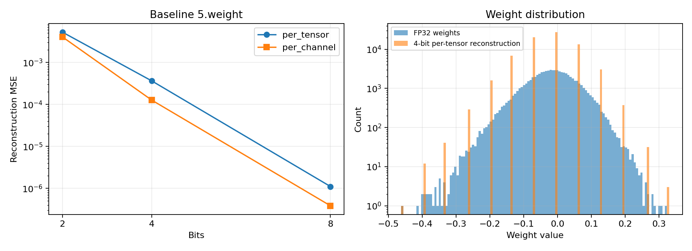
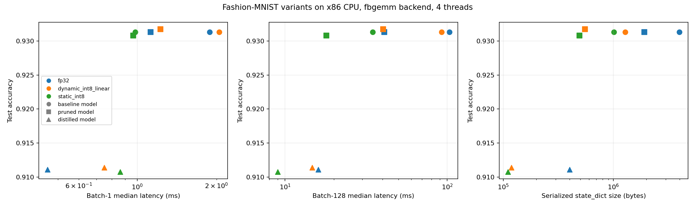

# Lab 8: Quantization, Model Export and Deployment Choices

## 1. Goal

I implemented weight quantization by hand to see where its error comes from. I then applied PyTorch dynamic and static INT8 quantization to the baseline, filter-pruned and distilled models from Lab 7, studied how the calibration data affects static quantization and exported FP32 models to ONNX. Finally, I chose a variant for each deployment target and delivered the project milestone.

## 2. Method

All models come from Lab 7: the 997,434-parameter teacher (`baseline`), the 50% filter-pruned teacher (`filters_50`, chosen automatically from [efficiency_summary.csv](../lab07/results/efficiency_summary.csv)) and the distilled student. Lab 8 imports the Lab 7 data split, model definitions and timing code, so the test set and measurements are identical. Lab 7 must run first because its checkpoints in `data/lab07/` are required. Run Lab 8 with `.\.venv\Scripts\python.exe lab08\src\run_lab.py`. Package versions are in [versions.txt](results/versions.txt): PyTorch 2.3.1, ONNX 1.16.1 and ONNX Runtime 1.18.0.

The machine is an x86-64 AMD Ryzen 9 7945HX on Windows, so the quantized backend is **fbgemm**. The script stops on ARM, where qnnpack should be used and the latency would not be comparable. Inference uses four intra-op threads and one inter-op thread. Lab 7 runs with fully deterministic algorithms. PyTorch has no deterministic flag for the output resize inside quantized linear kernels, so Lab 8 uses `use_deterministic_algorithms(True, warn_only=True)`. That operation only allocates the output buffer and does not change values.

- **Manual quantization** ([manual_quantization.py](src/manual_quantization.py)). Symmetric quantization uses scale = max|w| / (2^(b−1) − 1), zero point 0, then rounding and clamping. I applied it at 8, 4 and 2 bits, per tensor and per output channel, to the 128×64×3×3 third convolution of the baseline. I recorded MSE, maximum error, SQNR, the number of levels used and the share of weights rounded to zero. The 8-bit codes match `torch.quantize_per_tensor` and `torch.quantize_per_channel` exactly. To measure the effect on the network, I also fake-quantized every convolution and linear weight at each setting and evaluated test accuracy.
- **Dynamic quantization** uses `quantize_dynamic` on `nn.Linear` with qint8. Weights are stored as INT8, and activation scales are computed at run time for every call. PyTorch's eager dynamic API does not support convolutions.
- **Static quantization** uses FX graph mode: `prepare_fx` with `get_default_qconfig_mapping('fbgemm')`, a calibration pass, then `convert_fx`. With this mapping, weights are per-channel INT8 and activations use histogram observers with fbgemm's reduced 7-bit activation range. Convolutions, linear layers and fused ReLUs all run in INT8. The default calibration set is 500 training images in a seeded random order ([calibration_indices.csv](results/calibration_indices.csv)).
- **Calibration study.** The baseline is re-quantized with four 500-image calibration sets: random training images, images of only class 0 (T-shirt/top), Gaussian noise with mean 0 and standard deviation 1, and blank images equal to the normalized background value.
- **ONNX** ([export_onnx.py](src/export_onnx.py)). The FP32 baseline and distilled student are exported with opset 17 and a dynamic batch dimension, then checked with `onnx.checker`. They are run with the ONNX Runtime CPU provider with the same thread settings. The script asserts that the maximum absolute logit difference against PyTorch over all 10,000 test images is at most 1e-4.

Size is the byte length of `torch.save(state_dict)`. Latency is the median of 300 batch-1 or 40 batch-128 passes after 5 warm-ups. The variants are timed one after another in one process, so differences of about 10% are within the run-to-run noise I observed in Lab 7.

## 3. Results

### Manual quantization of one convolution

| Bits | Granularity | Levels used | SQNR (dB) | Weights rounded to 0 | Network test accuracy (all layers) |
| --- | --- | --- | --- | --- | --- |
| 32 | FP32 | – | – | – | 93.13% |
| 8 | per tensor | 185 / 255 | 36.9 | 2.1% | 93.14% |
| 8 | per channel | 251 / 255 | 41.5 | 1.2% | 93.15% |
| 4 | per tensor | 13 / 15 | 11.8 | 37.4% | 92.92% |
| 4 | per channel | 15 / 15 | 16.3 | 21.1% | 93.29% |
| 2 | per tensor | 3 / 3 | 0.1 | 99.5% | 10.42% |
| 2 | per channel | 3 / 3 | 1.3 | 91.7% | 41.58% |

Every bit removed costs about 6 dB of SQNR, as expected. A single per-tensor scale is set by the largest weight in the whole tensor, so channels with small weights use only a few levels. Per-channel scales give each output channel its own range: 4.6 dB better at 8 bits and 4.6 dB better at 4 bits. At 8 bits the network is unaffected, and 4-bit per-channel weights still work. At 2 bits, symmetric quantization has only −1, 0 and +1. Per tensor, the threshold for a nonzero level is so high that 99.5% of the weights become zero and the network falls to chance accuracy. Details: [manual_quantization.csv](results/manual_quantization.csv) and [manual_quantization_accuracy.csv](results/manual_quantization_accuracy.csv).

### Variant comparison

| Variant | Source | Method | Test | Size | vs. baseline size | Batch-1 | Batch-128 |
| --- | --- | --- | --- | --- | --- | --- | --- |
| baseline | teacher | FP32 | 93.13% | 3.99 MB | 1.0× | 1.88 ms | 103.1 ms |
| dynamic_quant | teacher | dynamic INT8 Linear | 93.13% | 1.28 MB | 3.1× smaller | 2.05 ms | 92.3 ms |
| static_quant | teacher | static INT8 | 93.13% | 1.01 MB | 3.9× smaller | 0.98 ms | 34.7 ms |
| pruned | filters_50 | FP32 | 93.13% | 1.91 MB | 2.1× smaller | 1.12 ms | 40.9 ms |
| pruned_dynamic_quant | filters_50 | dynamic INT8 Linear | 93.17% | 0.55 MB | 7.2× smaller | 1.23 ms | 40.2 ms |
| pruned_static_quant | filters_50 | static INT8 | 93.08% | 0.49 MB | 8.1× smaller | 0.97 ms | 17.9 ms |
| distilled | student | FP32 | 91.11% | 0.40 MB | 10.0× smaller | 0.46 ms | 16.0 ms |
| distilled_dynamic_quant | student | dynamic INT8 Linear | 91.14% | 0.12 MB | 33.7× smaller | 0.75 ms | 14.7 ms |
| distilled_static_quant | student | static INT8 | 91.08% | 0.11 MB | 36.4× smaller | 0.86 ms | 9.0 ms |

Full table with p95 values: [variant_comparison.csv](results/variant_comparison.csv).

INT8 quantization changed accuracy by at most 0.05 points for all three models, which is within the noise of a 10,000-image test set.

Dynamic quantization reduced the teacher by 3.1× because 90% of its parameters are in the linear layers, but it did not make inference meaningfully faster: batch 1 went from 1.88 to 2.05 ms, and batch 128 improved by only 10%, which is within the measurement noise. About 97% of the teacher's MACs are in its convolutions, which dynamic quantization leaves in FP32. At batch 1, the cost of computing activation scales and converting between FP32 and INT8 outweighs the saving in the small linear layers.

Static quantization runs the convolutions in INT8 too: the teacher became 1.9× faster at batch 1 and 3.0× faster at batch 128. Combined with filter pruning, it reached 5.8× the baseline throughput at batch 128 and 8.1× smaller weights, with the same accuracy within 0.05 points. For the tiny student, quantization reduced batch-128 time by 44% but made batch-1 latency slower (0.86 ms against 0.46 ms). With only 1.1 M MACs per image, the fixed quantize/dequantize and kernel-call overhead is larger than the arithmetic saved. Quantization pays off when there is enough computation to speed up.

### Calibration study

| Calibration set (500 images) | Input mean | Input std | Test accuracy |
| --- | --- | --- | --- |
| Random training images (default) | −0.05 | 0.97 | 93.13% |
| Only class 0 (T-shirt/top) | 0.12 | 1.00 | 93.16% |
| Gaussian noise | 0.00 | 1.00 | 93.08% |
| Blank background images | −0.81 | 0.00 | 83.76% |

Static quantization fixes a scale and zero point for every activation from the ranges observed during calibration, and these values are never updated at inference time. If calibration does not show the network realistic activations, those ranges are wrong. Real activations then either clip at the edge of the range or fall between too few levels. The calibration set must therefore come from the same distribution as the deployment inputs and contain the variety the model will see.

The blank set shows the failure clearly: constant inputs produce almost constant activations, the observed ranges are far too narrow, and accuracy fell by 9.4 points. The single-class and noise sets were less harmful than I expected on this model. The inputs are normalized, so both sets have activation ranges similar to real data, and the default histogram observer chooses ranges that minimize quantization error instead of the raw minimum and maximum. This is one seed on one small network. Because a deployed model will meet inputs that a single class or random noise cannot represent, I still use random training images. Details: [calibration_study.csv](results/calibration_study.csv).

### ONNX export

| Model | ONNX size | Max logit difference | Prediction agreement | PyTorch batch-1 | ORT batch-1 | PyTorch batch-128 | ORT batch-128 |
| --- | --- | --- | --- | --- | --- | --- | --- |
| baseline | 3.99 MB | 1.5e-5 | 100% | 1.98 ms | 0.51 ms | 94.3 ms | 59.9 ms |
| distilled | 0.40 MB | 1.1e-5 | 100% | 0.44 ms | 0.075 ms | 15.9 ms | 2.4 ms |

Both exports passed the 1e-4 tolerance and gave the same test predictions and accuracy as PyTorch. ONNX Runtime was 3.9× and 5.8× faster at batch 1, mostly because it fuses operators and has less per-call overhead than eager PyTorch. The ONNX file is the same size as the FP32 state_dict, because the format changes the runtime, not the precision. Details: [onnx_validation.csv](results/onnx_validation.csv).

### Deployment recommendations

| Target | Recommended variant | Reason |
| --- | --- | --- |
| Cloud (x86 server, batched) | `pruned_static_quant` | Highest batch throughput among full-accuracy models: 17.9 ms per 128 images, 5.8× the baseline, at 93.08%. Runs with fbgemm on x86 servers. |
| Edge (x86 or similar CPU gateway, single requests) | `pruned_static_quant`, or the distilled FP32 model in ONNX Runtime if 2 points of accuracy can be traded | 0.97 ms at batch 1 with 0.49 MB of weights and teacher-level accuracy. The distilled ONNX model takes 0.075 ms when latency matters more than accuracy. |
| Mobile (ARM phone) | `distilled_static_quant`, re-quantized with qnnpack | 110 KB and 91.1% accuracy. My latency numbers are x86 fbgemm measurements; on ARM it must be converted with the qnnpack backend or an ONNX/mobile runtime and re-measured on the device. |
| TinyML (microcontroller) | `distilled_static_quant` weights are the only candidate, but not deployable as-is | 110 KB of INT8 weights could fit in typical MCU flash, but the PyTorch FX model cannot run on a microcontroller. It needs conversion to an integer-only runtime such as TensorFlow Lite Micro, and its activation memory must be checked against the SRAM budget. |

### Project milestone

The project milestone is in [project/README.md](../project/README.md). It contains the SMS spam data pipeline (SHA-256 checks, validation, deduplication and a stratified 70/15/15 split), a TF-IDF + Logistic Regression baseline and a TF-IDF + MLP FP32 baseline logged with MLflow, and [metrics.json](../project/results/metrics.json). The FP32 MLP reaches test spam F1 0.9519 with a p95 batch-1 latency of 0.98 ms and 690 KB of artifacts. That meets the proposed targets of F1 ≥ 0.90, p95 ≤ 50 ms and ≤ 5 MB. Dynamic INT8 quantization of its linear layers is the next project step.

## 4. Conclusions

1. 8-bit weights did not lose accuracy here; precision only failed at 2 bits. Per-channel scales consistently reduced the error because they follow each channel's own range.
2. Quantization only helps latency where the quantized operations do most of the work. Dynamic quantization of linear layers shrank the CNN but did not speed it up. Static quantization of the convolutions gave the largest speed-up, and on a very small model, conversion overhead made batch-1 latency worse.
3. Static quantization depends on calibration data, and the deployment format matters as much as precision. A degenerate calibration set cost 9.4 points, while ONNX Runtime gave up to 5.8× lower latency with numerically equivalent FP32 output. The right variant depends on the target hardware and its backend, so a deployment choice has to be measured on that hardware.

Sources: supplied Lab 8 manual; Vijay Janapa Reddi, Introduction to Machine Learning Systems, Chapter 10 (quantization and precision), Chapter 11 (AI acceleration) and Chapter 14 (on-device and TinyML deployment); Jacob et al. (2018), Quantization and Training of Neural Networks for Efficient Integer-Arithmetic-Only Inference; PyTorch quantization (FX graph mode) documentation; ONNX and ONNX Runtime documentation.
